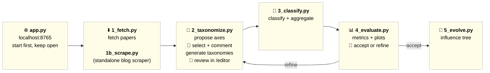

# SurveyMaster

Classify research papers against hierarchical taxonomies using multi-model LLM consensus voting. Different LLMs have complementary organizational intuitions; aggregating their confidence-weighted votes produces more reliable classifications than any single model alone. Includes an iterative refinement loop that measures taxonomy coverage and re-prompts the LLM to fix structural imbalances.

**Try it in the browser:** [jahody.github.io/surveymaster](https://jahody.github.io/surveymaster/) runs the whole pipeline client-side. Open one of the bundled runs, or bring an OpenRouter key and start your own topic.

## Pipeline



**Stage details:**

| Script | What it does |
|--------|-------------|
| `1_fetch.py` | Fetch arXiv papers via Asta MCP or Semantic Scholar. Three content sources: `abstracts` (metadata only), `blogPosts` (AlphaXiv summaries via Playwright, scraped automatically), `papers_markdown` (full text). Stored under `papers/{topic}/` |
| `1b_scrape.py` | Standalone AlphaXiv blog scraper — batch-scrape blog posts for papers already in `search_results.json` |
| `2_taxonomize.py` | LLMs propose taxonomy axes → 👤 human selects + adds comments → LLM generates full taxonomies → 👤 human reviews in `/editor`. Saves approved axes to `axes_approved.json` |
| `3_classify.py` | Classify papers × taxonomies × models in parallel (AsyncOpenAI + semaphore), then aggregate via confidence-weighted majority voting. Use `taxonomy.reclassify=true` to clear and redo |
| `4_evaluate.py` | 8 consistency/quality metrics + plots → 👤 human decides to accept or auto-refine. If refining, fixes dead/fat leaves via LLM re-prompting |
| `5_evolve.py` | Multi-model consensus to build a paper influence/lineage tree using chronological arXiv metadata |
| `evaluate_gt.py` | Evaluate classification results against Ground Truth (GT) taxonomies. Calculates top-1 accuracy, top-k recall, ECE, Brier score, and statistical significance of consensus voting. |

**NotebookLM Integration:**
A parallel set of scripts (`nl_scripts/2_taxonomize_nl.py`, `3_classify_nl.py`, `4_evaluate_nl.py`, `5_evolve_nl.py`) exists to leverage Google NotebookLM for taxonomy generation, classification, and pipeline evaluation, using the `notebooklm-py` library.

## Setup

```bash
python -m venv venv && venv\Scripts\activate
pip install -r requirements.txt
```

Create `.env`:
```
OPENROUTER_API_KEY=...
ASTA_API_KEY=...
```

## Running

```bash
python app.py            # Web UI at http://localhost:8765 — start first, keep open
```

Pipeline stages (run in order):
```bash
python 1_fetch.py        # Fetch papers (+ blog scraping if source=blogPosts)
python 1b_scrape.py      # (optional) Standalone blog scraper for existing search_results.json
python 2_taxonomize.py   # Propose axes → select → generate taxonomies → review
python 3_classify.py     # Classify papers + aggregate consensus
python 3_classify.py taxonomy.reclassify=true  # Force reclassification (clears existing results)
python 4_evaluate.py     # Evaluate metrics → accept or refine
python 5_evolve.py       # Generate paper influence/evolution tree

# Ground Truth Evaluation
python evaluate_gt.py    # Evaluate classifications against taxonomies_GT/ labels

# NotebookLM Workflow
# Use the scripts in nl_scripts/ for the NotebookLM-powered pipeline
python nl_scripts/2_taxonomize_nl.py
python nl_scripts/3_classify_nl.py
python nl_scripts/4_evaluate_nl.py
python nl_scripts/5_evolve_nl.py
```

## Data in this repo

Three topics under `papers/`: `efficient-reasoning-LLM` (77 papers), `implicit-reasoning-LLM` (42) and `latent-reasoning` (89). Each has:

| Folder | Contents |
|--------|----------|
| `abstracts/` | Title, arXiv ID, date, authors and abstract per paper (the `abstracts` source) |
| `taxonomies/` | The taxonomy the papers were classified against |
| `taxonomies_GT/` | Ground-truth taxonomy with paper assignments, extracted from a published survey of the topic: [A Survey of Efficient Reasoning for Large Reasoning Models](https://arxiv.org/abs/2503.21614), [Implicit Reasoning in Large Language Models: A Comprehensive Survey](https://arxiv.org/abs/2509.02350) and [A Survey on Latent Reasoning](https://arxiv.org/abs/2507.06203). Extraction prompt: `prompts/GT-extraction.md` |
| `classification/{provider}/{model}/` | Per-model top-3 classifications with confidences and reasons (DeepSeek V3.2, Gemini 3.1 Flash Lite, GPT-5 nano) |
| `classification/_consensus/` | Confidence-weighted consensus per paper |
| `evaluation/` | The 8 consistency metrics and plots |

Not included: the AlphaXiv blog summaries (`blogPosts/`) and full-text papers (`papers_markdown/`), which belong to their authors. Rebuild them locally with `1_fetch.py` / `1b_scrape.py`. Abstracts and survey taxonomies remain the work of their original authors.

## Evaluation metrics (`4_evaluate.py`)

| # | Metric | What it measures |
|---|--------|-----------------|
| 1 | Pairwise Cohen's kappa | Per-pair model agreement |
| 2 | Fleiss' kappa | Multi-rater agreement across all models |
| 3 | Consensus strength | Winning margin between top-1 and runner-up |
| 4 | Confidence–agreement correlation | Whether high-confidence predictions align with consensus |
| 5 | Per-model deviation | Which model diverges most from consensus |
| 6 | Taxonomy difficulty | Unanimous/majority rates + entropy per taxonomy |
| 7 | **Coverage analysis** | Papers per leaf, dead categories, fat categories, Gini, normalized entropy |
| 8 | **Cross-taxonomy independence** | Cramér's V between taxonomy pairs — flags redundant perspectives |

Outputs: `papers/{topic}/evaluation/consistency_metrics.json` + 6 PNG plots.

## Web UI

- `/papers` — browse papers by topic
- `/editor` — curate taxonomy JSON
- `/classification` — compare model predictions side by side
- `/evaluation` — consistency metrics and plots
- `/evolution-tree` — paper influence timeline

## Config

All settings in `config.yaml` (Hydra/OmegaConf): models, paper source, concurrency, top-k, refinement thresholds.

Key refinement thresholds (`refinement:` section):
- `dead_threshold: 0` — leaves with ≤ this many papers are dead
- `fat_multiplier: 2.5` — leaves with > mean × this are overcrowded
- `min_coverage_entropy: 0.7` — skip refinement if normalized entropy ≥ this and no dead leaves

## License

The code is under the [MIT License](LICENSE). The paper abstracts and the survey-derived ground-truth taxonomies in `papers/` remain the work of their original authors and are included for research reproducibility.
